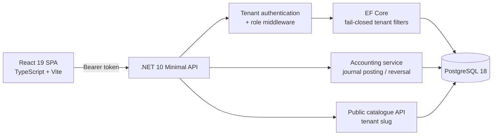

# NEXA ERP

**Multi-tenant ERP for motorcycle dealerships** — inventory, sales, branch stock, accounting, customer history and a public product catalogue in one application.

Built with **.NET 10**, **React 19 / TypeScript** and **PostgreSQL 18**. The interface is Turkish; the domain model is designed for dealerships with multiple branches and independent tenant businesses.

> Pilot deployment: AWS Lightsail + Caddy (automatic HTTPS) + systemd, with daily PostgreSQL backups and a CI pipeline.

---

## Why this project is interesting

- **Real multi-tenancy, not a `WHERE tenantId = ?` afterthought.** Every tenant-owned entity has a required `TenantId`, EF Core query filters fail closed when no tenant context exists, writes are stamped server-side, and composite foreign keys stop cross-tenant references at the database level.
- **Stock and accounting stay consistent.** Sales, edits and cancellations run in a transaction, adjust the correct branch stock, post double-entry journal records and reverse them on correction. Cancelling a sale also removes its linked collections and reverses their journal entries.
- **Cost-aware profitability.** Weighted-average purchase cost, cost snapshot at sale time, and accessory/service cost tracking so reported gross profit is not inflated.
- **Operational safety.** Audit trail for sensitive actions, login rate limiting, subscription/trial enforcement with a grace period, database-aware health checks, and a documented backup/restore drill.

---

## Features

### Sales & inventory
- Motorcycle inventory with purchase cost, sale price, colour, engine capacity and image URL.
- Sales with cash/card split, card instalments, past/future sale dates and reservation → invoice flow.
- Accessory and service line items with their own price and cost.
- Admin-only sale editing with automatic stock correction and accounting re-posting.
- Sale cancellation with stock return, payment cleanup and journal reversal.
- Customer cards, phone search and per-customer sales history.
- Stock ledger (opening, purchase, manual in/out, sale, return, transfer) and low-stock warnings.

### Branches & multi-tenancy
- Tenant (business) and dealer (branch) separation.
- Per-branch stock, inter-branch consignment/wholesale transfers.
- Tenant-aware login, tokens and public catalogue URLs.
- User and branch quotas per plan.

### Finance & reporting
- Chart of accounts, journal entries, trial balance, balance sheet and income statement.
- Cash/bank collections and payments, expenses, profitability and dealer performance reports.
- Turkish-format CSV export (UTF-8 BOM, semicolon separated).
- Date filters interpreted in the tenant time zone (`Europe/Istanbul` by default).

### Catalogue & operations
- Public, tenant-scoped catalogue with branding, filters and WhatsApp contact link.
- Shared workflow records for calendar, service, purchasing, trade-in, CRM, finance and automation.
- Audit log viewer, user management and tenant/package screen.

### Platform & security
- PBKDF2-SHA256 password hashing (210k iterations) and signed 8-hour bearer tokens.
- Admin/Staff/Dealer role checks enforced in API middleware, not only in the UI.
- Login rate limit (10 attempts/minute/IP), trial and subscription expiry enforcement (`402`).
- Public health endpoint that also probes PostgreSQL.
- Per-tenant data isolation tests, sale lifecycle tests and subscription tests.

---

## Architecture



The API is organised as minimal-API endpoint groups (`Program.cs`, `ErpEndpoints.cs`, `OperationsEndpoints.cs`) with a shared `AccountingService` and `AppDbContext`. The frontend consumes the API through a small typed client and feature pages under `frontend/src`.

### Repository layout

```text
src/MotorcycleSales.Api/       .NET 10 API, EF Core model, accounting service
frontend/                      React + TypeScript + Vite application
tests/                         PostgreSQL-backed integration tests
database/                      Idempotent schema and upgrade scripts
deploy/aws/                    Lightsail setup, systemd, Caddy and backup units
docs/                          API reference, roadmap and build status
.github/workflows/ci.yml       Build, lint and integration tests
```

---

## Tech stack

| Layer | Technology |
|---|---|
| API | .NET 10, ASP.NET Core Minimal APIs, EF Core 10, Npgsql |
| Database | PostgreSQL 18 |
| Frontend | React 19, TypeScript 6, Vite 8, hand-written CSS |
| Auth | PBKDF2-SHA256, HMAC-signed bearer tokens, role middleware |
| Tests | xUnit, `WebApplicationFactory`, disposable PostgreSQL databases |
| Deployment | AWS Lightsail, Caddy, systemd, `pg_dump` backup timer |

---

## Getting started

### Prerequisites
- .NET 10 SDK
- Node.js 22+
- PostgreSQL 18 with `psql` available

### 1. Create the database

```bash
createdb -U postgres MotorcycleSalesAPP
psql -U postgres -d MotorcycleSalesAPP -f database/schema_current.sql
```

`schema_current.sql` is the complete current schema. Existing installations use the idempotent `database/upgrade_*.sql` scripts instead.

### 2. Configure the API

```bash
dotnet user-secrets set "ConnectionStrings:DefaultConnection" \
  "Host=localhost;Port=5432;Database=MotorcycleSalesAPP;Username=postgres;Password=YOUR_PASSWORD" \
  --project src/MotorcycleSales.Api
```

For production, also set a strong `Jwt:Secret` (32+ random characters) and, only if you need tenant provisioning, `SaaS:ProvisioningKey`. Never commit either value.

### 3. Run the API

```bash
dotnet run --project src/MotorcycleSales.Api
```

API: `http://localhost:5172` — health: `http://localhost:5172/api/health`

### 4. Run the frontend

```bash
cd frontend
npm ci
npm run dev
```

UI: `http://localhost:5173`

### 5. First login

On the login screen choose **first-time setup**, enter a username and a password of at least 12 characters. Bootstrap only works while no users exist and only in the Development environment.

---

## Tests

```bash
dotnet test tests/MotorcycleSales.Api.Tests/MotorcycleSales.Api.Tests.csproj
```

The suite creates a throwaway PostgreSQL database, loads `database/schema_current.sql`, runs the tests and drops the database. It defaults to `postgres/postgres` on `127.0.0.1:5432`; override with `NEXA_TEST_ADMIN_CONNECTION`.

Covered scenarios:

- health endpoint reports database availability;
- accessory/service cost is included in COGS and gross profit;
- cancelling a sale restores stock, removes linked payments and reverses journals;
- payments cannot be added to a cancelled sale;
- one tenant cannot read or update another tenant's records;
- an expired trial blocks business endpoints with `402` while profile and plan requests still work.

Frontend checks:

```bash
cd frontend
npm run lint
npm run build
```

CI runs lint, the production build and the integration tests against PostgreSQL 18 on every push and pull request.

---

## Configuration

| Setting | Purpose |
|---|---|
| `ConnectionStrings__DefaultConnection` | PostgreSQL connection string |
| `Jwt__Secret` | Token signing key (required outside Development) |
| `SaaS__ProvisioningKey` | Protects the tenant provisioning endpoint; remove it after onboarding |
| `SaaS__TimeZone` | Report day-boundary time zone (default `Europe/Istanbul`) |
| `Cors__AllowedOrigins__0` | Frontend origin allowed to call the API |
| `VITE_API_BASE` | Frontend API base URL (default `http://localhost:5172/api`) |
| `VITE_TENANT_SLUG` | Default tenant slug for the public catalogue |

---

## Deployment

AWS Lightsail instructions live in [`deploy/aws/README-AWS.md`](deploy/aws/README-AWS.md): server setup, Caddy HTTPS, systemd service, idempotent database upgrades, API/web rollout, automatic daily backups and restore verification.

The backup timer writes custom-format `pg_dump` files to `/var/backups/nexa`, keeps 30 days and verifies each dump with `pg_restore --list`.

---

## API

A quick reference is in [`docs/API.md`](docs/API.md). Protected routes require `Authorization: Bearer <token>`; the public catalogue is tenant-scoped by URL slug.

---

## Roadmap

The current release is a working pilot, not a finished commercial ERP. Planned work:

- online subscription billing and payment-provider webhooks;
- email/WhatsApp notifications, invitations and password reset;
- TOTP two-factor authentication and session revocation;
- PDF invoices/quotes and Excel exports;
- dedicated service work orders, parts catalogue, purchasing and customer current accounts;
- pagination and row-level locking for high-volume concurrent sales;
- managed object storage for vehicle images.

The full delivery plan is in [`docs/SAAS_ROADMAP.md`](docs/SAAS_ROADMAP.md).

---

## Status

Actively developed. The API builds with zero errors, the four PostgreSQL integration tests pass, the frontend lints with zero errors and the production bundle builds successfully. See [`docs/BUILD_STATUS.md`](docs/BUILD_STATUS.md) for the latest verification details.
